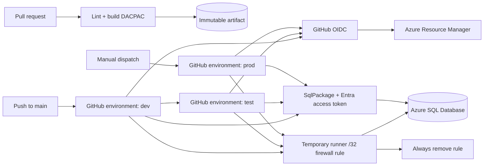

# Azure SQL DACPAC CI/CD proof of concept

Enterprise-oriented reference repository for building, validating, and promoting a SQL project to Azure SQL Database without passwords or permanent firewall rules. It contains equivalent Bicep and Terraform implementations; **nothing in this repository deploys infrastructure automatically**.

## Architecture



Private mode replaces the temporary public path with a private endpoint, private DNS, and a network-connected self-hosted runner.

## Repository map

| Path | Purpose |
|---|---|
| `database/` | SDK-style Microsoft.Build.Sql project and database objects |
| `scripts/` | Build, SQL policy/lint, and token-based SqlPackage deployment |
| `.github/workflows/` | PR validation and dev/test/prod promotion |
| `infra/bicep/` | Subscription-scope Bicep and environment parameters |
| `infra/terraform/` | Equivalent modular Terraform and environment tfvars |
| `.azure/` | Approved design record; not deployment state |
| `docs/` | Setup, architecture, security, planning, and troubleshooting |

## Quick start

```powershell
pwsh ./scripts/Test-Sql.ps1
pwsh ./scripts/Build-Dacpac.ps1
az bicep build --file ./infra/bicep/main.bicep
terraform -chdir=./infra/terraform init -backend=false
terraform -chdir=./infra/terraform validate
```

Replace every `YOUR_*`, all-zero GUID, and `replace1234` placeholder before use. Follow [setup](docs/setup.md), then choose **one** IaC implementation. Do not apply both to the same environment.

## Promotion behavior

* Pull requests lint and build but cannot request an Azure token.
* A push to `main` deploys dev automatically.
* A successful dev workflow triggers test, whose GitHub Environment can require approval.
* Production is manual and protected by the `prod` Environment.
* Every deployment rebuilds the selected commit, generates a report and SQL script, publishes with an Entra token, uploads evidence even on failure, and removes its uniquely named firewall rule in an `always()` step.

> Screenshot placeholder: GitHub Environments protection rules (`docs/images/github-environments.png`)
>
> Screenshot placeholder: successful dev → test workflow promotion (`docs/images/workflow-promotion.png`)
>
> Screenshot placeholder: Azure SQL networking blade with no permanent firewall rules (`docs/images/sql-networking.png`)

## Safety

The parameter examples are non-runnable placeholders. Infrastructure deployment is intentionally absent from GitHub workflows. Review generated deployment scripts before production approval. See [SECURITY.md](SECURITY.md).
